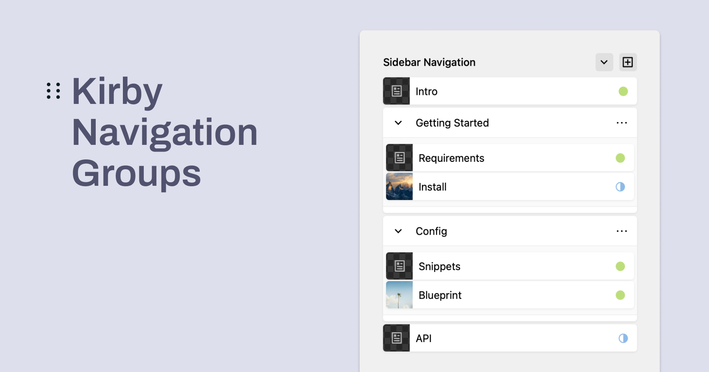

# Kirby Navigation Groups


A plugin for Kirby CMS that allows you to organize your navigation items into groups.



## Features

- Create and manage navigation groups
- Drag & drop interface for organizing pages
- Sync sort order with folder structure
- Multi-language support (EN, DE, FR, ES, IT)
- Customizable group fields

## Installation

Version 2 requires Kirby 6.0.0 or later and PHP 8.3 or later.

For Kirby 4 and 5, use [version 1.1.4](https://github.com/philippoehrlein/kirby-navigation-groups/releases/tag/v1.1.4).
The [support/kirby-4-5 branch](https://github.com/philippoehrlein/kirby-navigation-groups/tree/support/kirby-4-5) tracks that release line.

### Download

Download and copy this repository to `/site/plugins/kirby-navigation-groups`

### Composer
``` bash
composer require philippoehrlein/kirby-navigation-groups
```

For Kirby 4 and 5:

```sh
composer require philippoehrlein/kirby-navigation-groups:^1.1
```

## Usage

1. In your blueprint, add a field of type `navigationgroups`:


```yaml
fields:
  navigation:
    label: Navigation
    type: navigationgroups
```

2. Optional: Add custom fields to your groups and filter pages by status:

```yaml
fields:
  navigation:
    label: Navigation
    type: navigationgroups
    status: listed
    fields:
      description:
        type: textarea
        label: Description
      toggle:
        label: Toggle group
        type: toggle
        text:
          - "no"
          - "yes"
```


## Options

The plugin supports the following options:

- `status`: Filter for page status ('all', 'listed', 'unlisted', 'published', default: 'listed')
- `fields`: Additional fields for groups


## Field Methods
The plugin provides the Field Method `toGroupItems()` to access the stored navigation items:

```php
<?php
$items = $page->navigation()->toGroupItems();
?>

<nav class="navigation">
  <ul>
  <?php foreach ($items as $item): ?>
  <?php if ($item->type() == 'group'): ?>
    <li>
      <h2><?= $item->title() ?></h2>
      <ul>
        <?php foreach ($item->pages() as $subPage): ?>
          <li><a href="<?= $subPage->url() ?>"><?= $subPage->title() ?></a></li>
        <?php endforeach; ?>
      </ul>
    </li>
  <?php else: ?>
    <li><a href="<?= $item->url() ?>"><?= $item->title() ?></a></li>
  <?php endif; ?>
  <?php endforeach; ?>
  </ul>
</nav>
```

## Development

From the plugin repository root, install and start the local playground:

```sh
composer --working-dir=playground install
composer dev
```

Open [the test page](http://localhost:8000/) to see the rendered navigation.
On first use, create a local administrator at [the Panel](http://localhost:8000/panel), then open
[the test page in the Panel](http://localhost:8000/panel/pages/test).

The test page includes two listed children in a group, a standalone
child, an empty group and a draft. Drag a published child between groups or
change its status in the Panel, save, then reload the frontend to check the
result. The Navigation field includes listed and unlisted children. The draft
appears in the Pages section.

The playground installs Kirby from its own Composer lockfile and loads the
plugin and its built Panel assets from the current checkout. After editing
Panel source files, run `npm ci` and `npm run build` from the plugin root.
Panel accounts and runtime files are local. Changes saved to the sample pages
modify the tracked files under `playground/content`.

## License

This plugin is open-source and available under the [MIT License](LICENSE.md).